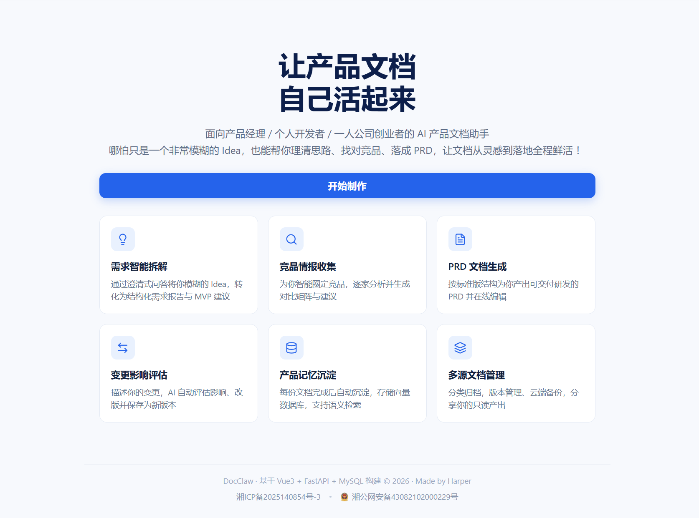

<h1 align="center">DocClaw</h1>

<p align="center">
  
  
  
  
  
</p>

<p align="center">
  <a href="https://github.com/thp322"></a>
  <a href="https://docclaw.harperwork.cn"></a>
</p>

<p align="center">
  <a href="https://docclaw.harperwork.cn">在线访问</a> |
  <a href="#这是什么">这是什么</a> |
  <a href="#一个-idea-的完整旅程">产品体验</a> |
  <a href="#技术架构">技术架构</a> |
  <a href="#快速开始">快速开始</a> |
  <a href="#环境变量">环境变量</a> |
  <a href="#项目结构">项目结构</a> |
  <a href="#部署上线">部署上线</a>
</p>
<p align="center">
  <a href="https://docclaw.harperwork.cn"></a>
</p>


面向产品经理 / 个人开发者 / 一人公司创业者的 **AI 产品文档助手**：哪怕只是一个模糊的 Idea，也能帮你理清思路、找对竞品、落成 PRD，让文档从灵感到落地全程鲜活。

---

## 这是什么

做产品最难的不是写文档，而是**从 0 到 1 的思考过程**：一个模糊的想法，要先澄清需求、再调研竞品、然后落成 PRD、上线后还要评估每次变更的影响。传统 AI 工具只能一问一答，产出散落各处、彼此无关。

DocClaw 把这条完整链路做成了一条流水线：

> 💡 模糊 Idea → 🎯 结构化需求 → 🔍 竞品矩阵 → 📄 可交付 PRD → 🔄 变更影响评估 → 🧠 全程记忆沉淀

所有产出自动进入**文档工作台**分类归档、版本管理、可分享；对话中提到的每个事实都会沉淀为**产品记忆**；管理后台维护的 **PM 专业知识库**则为方法论类问题提供有据可查的 RAG 回答。

## 一个 Idea 的完整旅程

| 阶段 | 模块 | 你会经历什么 |
| --- | --- | --- |
| 🎯 理清思路 | **需求智能拆解** | AI 用澄清式问题反问你（目标用户是谁？解决什么痛点？），把「我想做个 XX」逐步收敛成结构化需求报告与 MVP 范围建议 |
| 🔍 看清市场 | **竞品情报收集** | 自动圈定直接/间接竞品，逐家分析定位与打法，输出对比矩阵和差异化切入点 |
| 📄 落成文档 | **PRD 文档生成** | 按标准结构产出可直接交付研发的 PRD，支持在线编辑、多版本保存 |
| 🔄 应对变化 | **变更影响评估** | 描述一处变更（如「会员改成按次扣费」），AI 评估受影响的功能与文档，改版后另存新版本，历史版本随时回溯 |
| 🧠 越用越懂你 | **产品记忆 + 专业知识库** | 文档完成后自动提取事实记忆入向量库；对话提问时同时检索「你的私域记忆」与「团队 PM 知识库」，回答带来源引用 |

### 开始创作：一个对话框调度全部能力

不需要在功能页之间跳转。在「开始创作」里用自然语言说话，创作助手会在**每一轮自动判断意图**：

- *「什么是 RICE 优先级模型？」* → 检索 **PM 专业知识库**，挂 `[n]` 来源作答
- *「帮我把上次的需求做成 PRD」* → 确认后直接交接 **PRD 生成**
- *「我之前调研过哪些竞品？」* → 检索**私域产品记忆**
- *「我的产品是做什么的？」* → 读取产品画像，必要时引导更新

知识类问题强制走知识库检索：命中则**只依据片段作答并标注来源**；无命中时才允许用通用知识回答，并显式标注「通用知识，非知识库内容」——不编造、不幻觉引用。

### PM 专业知识库（管理后台）

- 仅最高权限账号可操作，支持 **PDF / TXT / Word(.docx) / Markdown(.md)**，一次可批量选择最多 10 份、单份 ≤ 20MB
- 文字版 PDF 直接解析（扫描件无文字层会明确拒绝，不静默产出乱码）；Markdown 自动清洗标题/链接/粗斜体标记为语义纯文本
- 每份文档按 1500 字语义切块并生成 embedding；内置检索测试面板，可实时查看 Top6 命中块与余弦分数
- 删除任意文档前，系统会**先自动把全文导出为 txt 下载到本地备份**，备份成功才执行删除

## 技术架构

```
┌─────────────────────────── 浏览器 ───────────────────────────┐
│  Vue 3 + TS + Pinia      SSE 流式渲染 / Markdown / 来源徽标     │
└───────────────┬───────────────────────────┬──────────────────┘
                │ /api (Nginx 反代)          │ /api/.../stream (SSE)
┌───────────────▼───────────────────────────▼──────────────────┐
│                        FastAPI                                │
│  ┌─────────────────────────────────────────────────────────┐ │
│  │            创作助手 Agent（双模型轮次协作）                │ │
│  │  工具轮(flash + function-calling)                        │ │
│  │    ├─ kb_search      专业知识库检索（全局共享）            │ │
│  │    ├─ start_feature  四大功能确认式交接                   │ │
│  │    ├─ list_my_assets 查我的文档资产                       │ │
│  │    └─ update_profile 更新产品画像                        │ │
│  │  回答轮(pro) 依据工具结果流式生成，伪工具调用自动纠偏       │ │
│  └───────────┬───────────────────────────┬─────────────────┘ │
│              │                           │                    │
│  ┌───────────▼─────────┐   ┌─────────────▼──────────────┐    │
│  │  PM 专业知识库 RAG   │   │  私域产品记忆（按用户隔离） │    │
│  │ knowledge_doc/chunk │   │  memory_item / memory_chunk│    │
│  │ 全局共享 · 无 user   │   │  每用户独立向量空间         │    │
│  └───────────┬─────────┘   └─────────────┬──────────────┘    │
│              └───────────┬───────────────┘                    │
│           百炼 1024 维 embedding + NumPy 余弦（无外部向量库）  │
└──────────────────────────┬───────────────────────────────────┘
                           │
                    MySQL 8.0（utf8mb4）
```

**关键设计**

- **双模型轮次协作**：工具轮用 flash 模型做意图识别与函数调用（快、便宜），回答轮用 pro 模型基于工具结果流式生成（好、稳）；查询改写零额外成本——工具模型在调用时直接把多轮指代词改写成自包含检索词
- **纯 NumPy 向量检索**：不依赖 Milvus/Faiss 等重组件，embedding 以 LONGBLOB 存 MySQL，进程内单例缓存 + 表指纹增量失效；知识库返回 Top6（候选池 12、相似度阈值 0.35、同一文档最多 2 块防霸榜）
- **物理隔离的两套 RAG**：知识库表全局共享、记忆表按 user_id 隔离，embedding 底层复用同一服务
- **健壮的流式链路**：SSE 全过程事件（工具开始/结果/流式正文/交接卡/来源），切换页面与刷新后可按后端落库阶段自动续跑；模型偶发把工具调用写成伪代码时，后端能合成执行 / 纠偏重试 / 兜底替换
- **商业化闭环**：JWT 三级角色 + 额度按次扣减（欢迎礼/每月福利）+ Pro 会员 + 支付宝电脑网站支付（异步通知 + 主动查单双兜底）
- **零手动迁移**：SQLAlchemy `create_all` 建新表，启动时对老库执行幂等 `ALTER TABLE` 补列

## 快速开始

**环境要求**：Python 3.11+ · Node.js 22+ · MySQL 8.0

```bash
# 1. 克隆并配置后端环境变量
git clone https://github.com/thp322/DocClaw.git
cd DocClaw
cp .env.example backend/.env        # 至少填写 DB 连接、JWT_SECRET、DASHSCOPE_API_KEY

# 2. 启动后端（http://127.0.0.1:8000，表结构启动时自动创建）
cd backend
pip install -r requirements.txt
uvicorn main:app --reload --port 8000

# 3. 启动前端（新终端；/api 自动代理到 8000）
cd frontend
npm install
npm run dev                         # http://localhost:5173
```

> 未配置 `DASHSCOPE_API_KEY` 时，AI 相关接口返回 503 并提示「AI 服务未配置」，注册/登录等非 AI 功能不受影响。

前端常用命令：

```bash
npm run dev          # 开发服务器（热更新）
npm run type-check   # vue-tsc 严格类型检查
npm run build        # 类型检查 + 生产构建
npm run lint         # oxlint + eslint
```

后端无需独立测试框架，可使用仓库内的 `backend/test_main.http`（IDE REST Client）手工调试接口。

## 环境变量

所有配置通过后端 `.env` 注入，完整模板见 [.env.example](.env.example)：

| 分组 | 关键变量 | 说明 |
| --- | --- | --- |
| 数据库 | `DB_HOST` `DB_USER` `DB_PASSWORD` `DB_NAME` | 本地连 127.0.0.1；容器部署由 compose 覆盖为服务名 `mysql` |
| 鉴权 | `JWT_SECRET` `JWT_ACCESS_EXPIRE_DAYS` | 生产务必替换为随机长串，Token 默认 7 天 |
| AI | `DASHSCOPE_API_KEY` | 阿里云百炼 Key，缺失则 AI 接口 503 |
| 额度 | `DEFAULT_QUOTA` `WELCOME_QUOTA` `MONTHLY_QUOTA` | 新用户初始额度、注册欢迎礼、每月福利（默认 0 / 20 / 10） |
| 邮件 | `ALIBABA_CLOUD_AK_ID` `ALIBABA_CLOUD_AK_SECRET` | DirectMail 发送邮箱验证码 |
| 头像 | `QINIU_ACCESS_KEY` `QINIU_BUCKET_NAME` … | 七牛云对象存储 |
| 支付 | `ALIPAY_ENABLED` `ALIPAY_ENV` `ALIPAY_APP_ID` `ALIPAY_RETURN_URL` … | 总开关默认关闭；sandbox/production 两套环境，私钥不入仓库 |

## 项目结构

```
DocClaw-vue-fastapi/
├── backend/
│   ├── main.py                    # FastAPI 入口：注册路由、启动建表、幂等补列
│   ├── config/                    # db/jwt/ai/quota/alipay/email/qiniu 配置
│   ├── models/                    # SQLAlchemy 模型
│   │   ├── users.py  ai.py  creator.py  memory.py  knowledge.py …
│   ├── routers/                   # HTTP 路由层（鉴权依赖 deps.py）
│   │   ├── ai_creator.py          # 创作助手 SSE
│   │   ├── ai_knowledge.py        # PM 知识库入库/列表/删除/重建/检索测试（role=3）
│   │   ├── ai_memory.py  ai_requirement.py  ai_competitor.py
│   │   ├── ai_prd.py  ai_impact.py  ai_docs.py  payments.py …
│   ├── schemas/                   # Pydantic v2 请求/响应模型
│   └── services/
│       └── ai/
│           ├── creator/           # agent.py 双轮编排 · tools.py 四工具 · prompts.py
│           ├── knowledge/         # parsers 解析 · chunks 切块 · vector_store · ingest
│           ├── memory/            # embedding · extraction 记忆提取 · ask 问答
│           ├── requirement.py · competitor.py · prd.py · impact.py · docs.py
│           └── billing.py · history.py · llm.py
├── frontend/
│   └── src/
│       ├── api/                   # http.ts 封装（Bearer 注入/统一错误/SSE）
│       ├── views/                 # Home/Workbench/Prd/Competitor/Impact/Memory/Admin…
│       ├── components/
│       │   ├── creator/           # 创作助手：动作流、[n]来源徽标、功能交接确认卡
│       │   ├── memory-ask/        # 记忆问答面板
│       │   └── admin/KnowledgeManager.vue   # 知识库弹窗（多文件批量入库）
│       ├── stores/                # Pinia：auth · toast · notification
│       ├── composables/           # SSE 流式进度
│       └── router/ layouts/ styles/
├── docker-compose.yml             # mysql + backend + frontend 三容器
├── .env.example                   # 部署环境变量模板
└── .github/workflows/deploy.yml   # push main → 构建镜像 → 部署阿里云
```

## 部署上线

生产环境为三容器架构，全部由 Docker Compose 编排：

- **mysql**：MySQL 8.0（utf8mb4），端口仅绑定宿主机回环地址，数据走 named volume 持久化
- **backend**：FastAPI 镜像，只读挂载服务器 `.env`，经 `docclaw-net` 连接数据库
- **frontend**：Nginx 镜像，静态托管构建产物并反代 `/api` → `backend:8000`；接入宿主机既有的 nginx-proxy + acme-companion，自动完成域名反代与 Let's Encrypt HTTPS 证书签发

**CI/CD**：向 `main` 分支推送即触发 GitHub Actions —— 构建前后端镜像、推送镜像仓库、SSH 登录阿里云拉取最新镜像并滚动重启。

线上地址：<https://docclaw.harperwork.cn>
